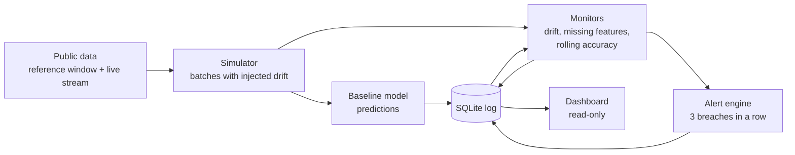

# ModelGuard

[](https://github.com/synamalhan/model-guard/actions/workflows/ci.yml)

A deployed model rarely fails loudly: its input data shifts, a feature quietly goes missing, and accuracy erodes
weeks before anyone gets the labels to prove it. ModelGuard is a small Python library and Streamlit dashboard that
watches for those three failures. It compares each live batch against a reference window, tracks the missing-value rate
per feature, and follows rolling accuracy and F1 as delayed labels arrive. It raises an alert only after several
consecutive bad batches, so one noisy batch does not page anyone. A drift simulator with known ground truth lets
you measure how fast, and how reliably, the monitors notice.

Demo GIF: TODO (to be recorded and saved as `docs/demo.gif`).

## Architecture

ModelGuard is a library (`src/modelguard/`) with two thin front ends: scripts that run it and a read-only dashboard.
All state lives in one SQLite file, so the dashboard never calls the monitors.



Each batch goes through the model, is logged, and is checked by the monitors. An alert fires only after three breaching
batches in a row. The dashboard reads the SQLite file and nothing else.

| Component | File | Responsibility |
|---|---|---|
| Data and split | `data.py`, `scripts/download_data.py` | Load Adult, verify the SHA-256, split by file order |
| Baseline | `train.py` | Fit the pipeline, write the model and holdout metrics |
| Store | `store.py` | The four SQLite tables and their read and write functions |
| Monitors | `monitors.py`, `performance.py` | Typed `MonitorResult` per detector, thresholds from `configs/monitors.yaml` |
| Alerts | `alerts.py` | Consecutive-breach rule, one alert per streak |
| Simulator | `simulator.py`, `runner.py` | Scenarios, drift injection, delayed labels, end-to-end run |
| Dashboard | `dashboard_data.py`, `dashboard.py` | Data layer and thin UI over SQLite |
| Evaluation | `evaluation.py`, `scripts/evaluate.py`, `scripts/make_tables.py` | Seed-split tuning and reporting, generated results table |
| Registry | `registry.py` | One JSON record per run for reproducibility |

## Quickstart

From a clean clone (needs Python 3 and `make`):

```bash
git clone https://github.com/synamalhan/model-guard.git
cd model-guard
make setup     # virtualenv plus pinned dependencies
make test      # pytest on synthetic data; no download needed
make lint      # ruff
make train     # downloads Adult (checksum verified), trains the baseline, writes models/ and results/baseline.json
make simulate  # replays every scenario in configs/scenarios on real data and prints detection delay
make eval      # tunes on seeds 0-9, reports on seeds 10-29, regenerates the results table below
make demo      # simulates a sudden shift and opens the dashboard
```

Datasets and model weights are never committed. `make train` downloads the data and verifies its checksum; see
[docs/DATA.md](docs/DATA.md) for the source and license.

## Results

Everything between the markers below is generated by `make eval` from the files in `results/eval/`. Do not edit it by hand.

<!-- RESULTS:START -->
Method: every scenario was run on 20 held-out seeds (10-29); thresholds were tuned on separate seeds (0-9) with a budget of at most 1.0 false alarms per 100 clean batches. Each stream has 40 batches of 500 rows, drift starts at batch 15, and an alert needs 3 consecutive breaching batches. An alert is correct if it is raised at or after the true drift batch; this counts alerts on any feature, so precision is lenient. Recall is the share of runs with at least one correct alert. Delay is the first correct alert minus the drift batch, over detected runs. Intervals are 95% Wilson. Seeds change the stream (shuffle, resampling, missing mask); the model and reference window are fixed.

| Scenario | Setting | Detected | Recall [95% CI] | Delay, batches (mean ± sd) | Precision [95% CI] | Alerts |
|---|---|---|---|---|---|---|
| gradual_shift | psi | 20/20 | 1.00 [0.84, 1.00] | 3.95 ± 0.22 | 1.00 [0.85, 1.00] | 21/21 correct |
| label_shift | psi | 20/20 | 1.00 [0.84, 1.00] | 4.50 ± 1.28 | 1.00 [0.93, 1.00] | 50/50 correct |
| missing_feature | psi | 20/20 | 1.00 [0.84, 1.00] | 2.00 ± 0.00 | 1.00 [0.85, 1.00] | 22/22 correct |
| sudden_shift | psi | 20/20 | 1.00 [0.84, 1.00] | 2.00 ± 0.00 | 1.00 [0.84, 1.00] | 20/20 correct |
| gradual_shift | ks | 20/20 | 1.00 [0.84, 1.00] | 2.25 ± 0.44 | 1.00 [0.85, 1.00] | 21/21 correct |
| label_shift | ks | 20/20 | 1.00 [0.84, 1.00] | 1.55 ± 0.69 | 1.00 [0.99, 1.00] | 318/318 correct |
| missing_feature | ks | 20/20 | 1.00 [0.84, 1.00] | 2.00 ± 0.00 | 1.00 [0.86, 1.00] | 23/23 correct |
| sudden_shift | ks | 20/20 | 1.00 [0.84, 1.00] | 2.00 ± 0.00 | 1.00 [0.84, 1.00] | 20/20 correct |
| gradual_shift | both | 20/20 | 1.00 [0.84, 1.00] | 2.25 ± 0.44 | 1.00 [0.91, 1.00] | 41/41 correct |
| label_shift | both | 20/20 | 1.00 [0.84, 1.00] | 1.55 ± 0.69 | 1.00 [0.99, 1.00] | 318/318 correct |
| missing_feature | both | 20/20 | 1.00 [0.84, 1.00] | 2.00 ± 0.00 | 1.00 [0.86, 1.00] | 23/23 correct |
| sudden_shift | both | 20/20 | 1.00 [0.84, 1.00] | 2.00 ± 0.00 | 1.00 [0.91, 1.00] | 40/40 correct |

| Clean stream, setting | False alarms | Clean batches | Per 100 clean batches |
|---|---|---|---|
| psi | 1 | 800 | 0.12 |
| ks | 1 | 800 | 0.12 |
| both | 1 | 800 | 0.12 |

| Setting | PSI threshold | KS / chi-square alpha | Within false-alarm budget (tuning seeds) |
|---|---|---|---|
| psi | 0.1 | n/a | yes |
| ks | n/a | 0.05 | yes |
| both | 0.3 | 0.05 | yes |
<!-- RESULTS:END -->

Where each number comes from:

- Per-run outcomes: [results/eval/runs.csv](results/eval/runs.csv)
- Every alert raised, with whether it was correct: [results/eval/alerts.csv](results/eval/alerts.csv)
- Thresholds and the seeds they were tuned on: [results/eval/tuned_thresholds.json](results/eval/tuned_thresholds.json)
- The full tuning grid: [results/eval/tune_grid.csv](results/eval/tune_grid.csv)
- The rendered table: [results/tables/results.md](results/tables/results.md)
- Baseline model holdout metrics: [results/baseline.json](results/baseline.json)
- Settings: [configs/monitors.yaml](configs/monitors.yaml), [configs/evaluation.yaml](configs/evaluation.yaml), [configs/scenarios/](configs/scenarios/)

## Limitations

What was not tested or is not claimed:

- All drift is synthetic and injected into one public dataset with one fixed model. Nothing here is evidence about real production traffic.
- Tuning seeds and reporting seeds shuffle the same live rows. It is a held-out seed split, not a held-out data split.
- The model and the reference window are fixed across seeds, so variance from retraining is not measured.
- Adult has no timestamps. The reference window is simply the leading rows of the file.
- Covariate shift is only injected into numeric features. There is no categorical shift scenario and no concept-drift scenario.
- The label-shift scenario resamples by class, which also changes the feature distributions, so it is not a pure label shift.
- Labels arrive after a fixed delay, not a realistic delay distribution.
- An alert counts as correct if it is raised at or after the true drift batch, on any feature, so precision is lenient.
- Thresholds were tuned on a coarse grid. The number of consecutive breaches, the missing-rate margin and the performance drop were not tuned.
- Nothing was load-tested. The log is a single-process SQLite file.
- The dashboard replays a finished run. It does not update live.
- CI runs on Linux only; development was on macOS.

## Layout

`src/modelguard/` library · `tests/` pytest · `configs/` monitors, evaluation and scenarios · `scripts/` entry points ·
`results/` generated outputs · `docs/` data notes and the [write-up](docs/writeup.md)

## License

Code: MIT, see [LICENSE](LICENSE). The Adult dataset has its own license; see [docs/DATA.md](docs/DATA.md).
